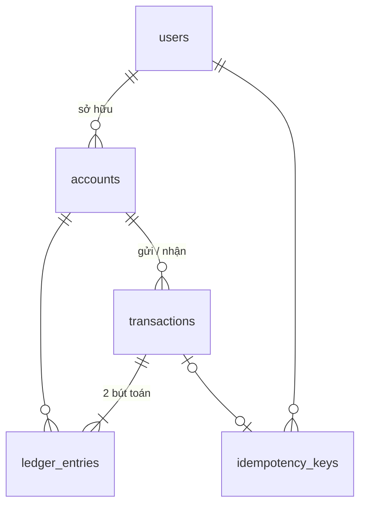

# Database (Phase 1)

PostgreSQL 16. Schema tạo bởi migration `backend/src/database/migrations/1760400000000-InitSchema.ts`.

## Các bảng

| Bảng | Cột chính | Ghi chú |
|---|---|---|
| `users` | id, full_name, email, password_hash, role, status | role: customer, admin. status: active, locked |
| `accounts` | id, user_id, account_number, balance, currency, status, is_system, version | status: active, frozen, closed |
| `transactions` | id, type, status, from_account_id, to_account_id, amount, description, failure_reason, initiated_by, completed_at | type: transfer, deposit. status: processing, completed, failed |
| `ledger_entries` | id, transaction_id, account_id, direction, amount, balance_after | Sổ cái kép, chỉ thêm dòng |
| `idempotency_keys` | (user_id, key), request_hash, transaction_id, response_code, response_body, expires_at | Chống gửi trùng |

## Quy tắc quan trọng

- **Tiền:** `numeric(18,2)`, không dùng float.
- **Sổ cái kép:** mỗi giao dịch completed có đúng 1 dòng `debit` cho tài khoản gửi và 1 dòng `credit` cho tài khoản nhận, cùng số tiền.
- **Tài khoản quỹ** `000000000000` (`is_system = true`) là nguồn tiền khi nạp tiền, được phép âm. Vì vậy tổng số dư mọi tài khoản luôn bằng 0. Dùng để kiểm tra nhanh: `SELECT sum(balance) FROM accounts;`
- **Ràng buộc trong DB**, là lớp bảo vệ cuối cùng nếu code có lỗi:
  - số dư tài khoản thường không âm
  - số tiền giao dịch lớn hơn 0
  - tài khoản gửi khác tài khoản nhận
  - số tài khoản đúng 12 chữ số
  - mỗi giao dịch không có 2 dòng sổ cái cùng chiều
- **Idempotency:** khóa chính `(user_id, key)` đảm bảo cùng user gửi cùng key chỉ được ghi một lần.

## Để dành cho Phase 2

- Chặn UPDATE/DELETE trên `ledger_entries` bằng trigger và phân quyền DB
- Bảng `audit_logs`, `fraud_flags`, `reconciliation_reports`
- Thêm vai trò operator, auditor (`ALTER TYPE user_role ADD VALUE ...`)
