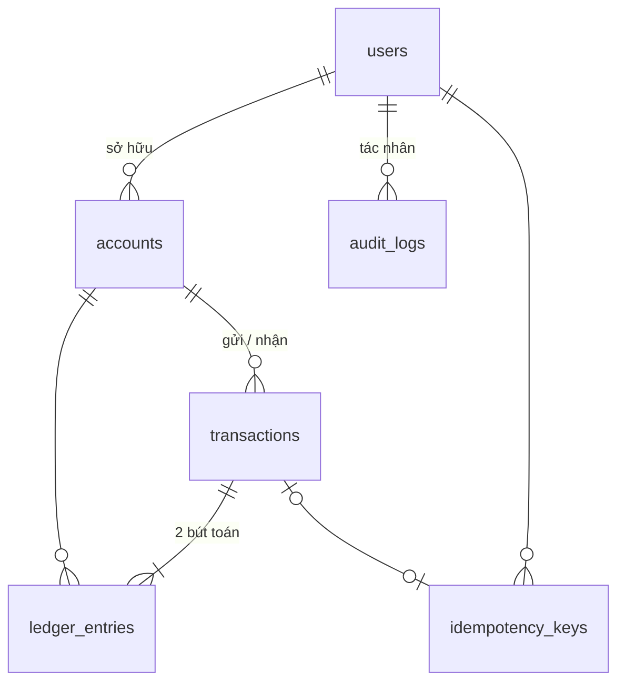

# Database (Phase 1)

PostgreSQL 16. Schema tạo bởi các migration trong `backend/src/database/migrations/`: `InitSchema` tạo bảng, `EnforceTransferLedgerIntegrity` và `RestrictLedgerMutation` thêm trigger và phân quyền bảo vệ sổ cái, `AddOperatorAuditorRoles` thêm vai trò operator, auditor (F1 Phase 2).

## Các bảng

| Bảng | Cột chính | Ghi chú |
|---|---|---|
| `users` | id, full_name, email, password_hash, role, status | role: customer, operator, auditor, admin. status: active, locked. Operator, auditor là nhân viên ngân hàng, không có tài khoản ngân hàng, chỉ tạo bằng seed |
| `accounts` | id, user_id, account_number, balance, currency, status, is_system, version | status: active, frozen, closed |
| `transactions` | id, type, status, from_account_id, to_account_id, amount, description, failure_reason, initiated_by, completed_at | type: transfer, deposit. status: processing, completed, failed |
| `ledger_entries` | id, transaction_id, account_id, direction, amount, balance_after | Sổ cái kép, chỉ thêm dòng |
| `idempotency_keys` | (user_id, key), request_hash, transaction_id, response_code, response_body, expires_at | Chống gửi trùng |
| `audit_logs` | id, actor_id, actor_role, action, target_type, target_id, request_id, ip, metadata (jsonb), created_at | Nhật ký kiểm toán (F2). **Chỉ thêm dòng**, xem chi tiết bên dưới |

## Quy tắc quan trọng

- **Tiền:** `numeric(18,2)`, không dùng float.
- **Sổ cái kép:** mỗi giao dịch completed có đúng 1 dòng `debit` cho tài khoản gửi và 1 dòng `credit` cho tài khoản nhận, cùng số tiền.
- **Tài khoản quỹ** `000000000000` (`is_system = true`) là nguồn tiền khi nạp tiền, được phép âm. Vì vậy tổng số dư mọi tài khoản luôn bằng 0. Dùng để kiểm tra nhanh: `SELECT sum(balance) FROM accounts;`
- **Ràng buộc trong DB**, là lớp bảo vệ cuối cùng nếu code có lỗi:
  - số dư tài khoản thường không âm
  - số tiền giao dịch lớn hơn 0
  - tài khoản gửi khác tài khoản nhận
  - số tài khoản đúng 12 chữ số
  - mỗi giao dịch không có 2 dòng sổ cái cùng chiều
- **Idempotency:** khóa chính `(user_id, key)` đảm bảo cùng user gửi cùng key chỉ được ghi một lần.
- **Giao dịch failed (TV3, F4):**
  - Lỗi `INSUFFICIENT_FUNDS`, `SENDER_ACCOUNT_NOT_ACTIVE`, `TARGET_ACCOUNT_NOT_ACTIVE` sau khi rollback được lưu thành `transactions.status = failed`, `failure_reason` là mã lỗi, `completed_at` null. Trigger sổ cái chỉ kiểm tra giao dịch `completed`, nên giao dịch `failed` không có dòng `ledger_entries` nào.
  - Lưu trong transaction riêng, cùng với `idempotency_keys` (`response_code = 422`, `transaction_id` trỏ tới giao dịch failed) và audit log `transfer_failed`.
  - Trước khi `INSERT transactions`, khóa `FOR KEY SHARE` hai tài khoản theo đúng thứ tự số tài khoản mà lệnh chuyển dùng. Khóa ngoại tự khóa theo thứ tự from rồi to, có thể ngược thứ tự `FOR UPDATE` của lệnh chuyển chiều kia và gây deadlock.
- **Sổ cái chỉ thêm dòng (TV3):**
  - Trigger chặn `UPDATE`, `DELETE`, `TRUNCATE` trên `ledger_entries`.
  - Trigger kiểm tra lúc commit: giao dịch transfer `completed` phải có đúng 1 dòng debit, 1 dòng credit, đúng số tiền và đúng tài khoản. Sai thì cả transaction bị hủy.
- **Audit log chỉ thêm dòng (TV2, F2):**
  - `banking_app` chỉ có `SELECT`, `INSERT` trên `audit_logs`; `PUBLIC` bị `REVOKE ALL`.
  - Trigger chặn `UPDATE`, `DELETE`, `TRUNCATE` kể cả với owner, trừ khi thành viên role `audit_maintainer` bật `app.audit_maintenance` trong transaction.
  - `request_id` là varchar(64) vì `RequestIdMiddleware` chấp nhận header `X-Request-Id` do client gửi; khi ghi log ngoài request (worker) giá trị là `no-request-context`.
  - Log của thao tác có thay đổi dữ liệu (khóa/mở user, đăng ký) ghi **trong cùng DB transaction** với thao tác đó; đăng nhập thành công/thất bại không có transaction bao ngoài nên ghi độc lập.
  - Không bao giờ ghi mật khẩu, token vào `metadata`.
  - Thêm action mới không cần migration (cột varchar), đặt trong enum `AuditAction` của `audit-log.entity.ts`.

## User database

| User | Dùng cho | Quyền |
|---|---|---|
| `bank` (`DB_USER`) | Migration, seed, dọn dữ liệu test, DBeaver/pgAdmin | Chủ schema |
| `bank_app` (`DB_APP_USER`) | Backend khi chạy | Role `banking_app`: đọc, thêm, sửa các bảng nghiệp vụ; với `ledger_entries` chỉ `SELECT`, `INSERT` |

- Tạo hoặc cập nhật `bank_app`: `npm run db:app-user`, chạy sau `migration:run`. Docker tự chạy bước này khi container khởi động.
- **Migration tạo bảng mới phải tự `GRANT` cho `banking_app`**, nếu không backend sẽ lỗi `permission denied`.
- Muốn sửa hoặc xóa sổ cái (dọn dữ liệu test, xử lý sự cố) phải dùng user thuộc role `ledger_maintainer` và bật `app.ledger_maintenance` trong transaction. Xem `backend/test/support/owner-data-source.ts`.

## Phase 2 (dự kiến)

Người phụ trách được chỉnh khi làm và cập nhật mục này trong cùng PR. Yêu cầu chi tiết xem [phan-cong-cong-viec.md](phan-cong-cong-viec.md).

| Thay đổi | Nội dung | Phụ trách | Tuần |
|---|---|---|---|
| Enum `user_role` | **Xong tuần 7:** có `customer`, `operator`, `auditor`, `admin` | TV2 | 7 |
| Bảng `audit_logs` | **Xong tuần 7:** xem mục "Audit log chỉ thêm dòng" ở trên | TV2 | 7 |
| `users` | Thêm cột đếm số lần đăng nhập sai, thời điểm hết tạm khóa | TV2 | 9 |
| `transactions` | **Xong tuần 7:** dùng trạng thái `failed` kèm `failure_reason`, không cần migration. Xem quy tắc "Giao dịch failed" ở trên | TV3 | 7 |
| Bảng `outbox_events` | id, event_type, payload (jsonb), status, attempts, available_at, created_at, processed_at | TV3 | 8 |
| Bảng `fraud_flags` | id, transaction_id, rule_code, score, status (open, confirmed, dismissed), reviewed_by, reviewed_at, note, created_at | TV3 | 8 |
| Bảng `reconciliation_reports` | id, run_at, status, số tài khoản lệch, chi tiết (jsonb) | TV1 | 8 |

**Quy tắc cho migration Phase 2:**
- Bảng mới phải `GRANT` cho `banking_app`. Bảng chỉ thêm dòng (`audit_logs`) chỉ cấp `SELECT`, `INSERT`, kèm trigger chặn sửa, xóa.
- Log và sự kiện của một thao tác ghi trong cùng DB transaction với thao tác đó.
- Mỗi migration có `down` chạy được. Sau khi thêm migration, chạy `migration:generate --dryrun` phải báo không có thay đổi, tức là entity khớp với migration.

**Còn để sau:**
- Đối soát bằng code (F7) thay cho kiểm tra tay. Sau khi có F7, chặn thêm việc đổi trạng thái giao dịch đã `completed`.
