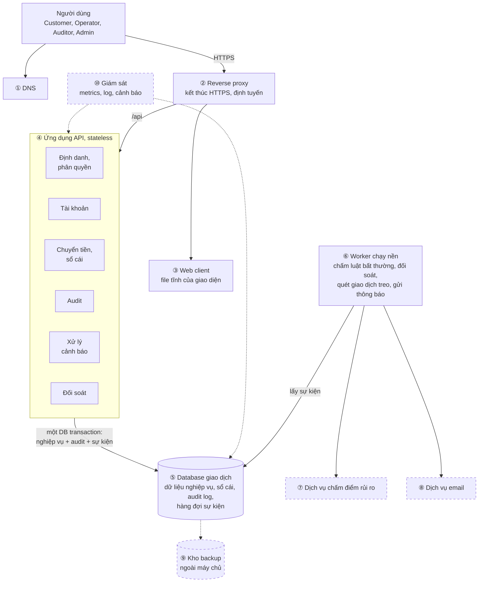
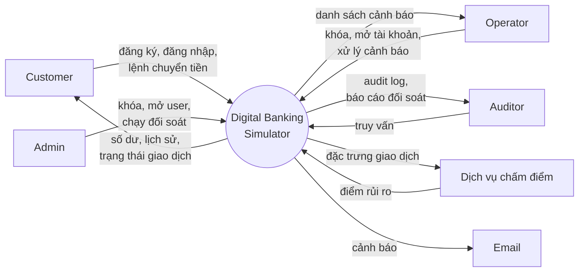
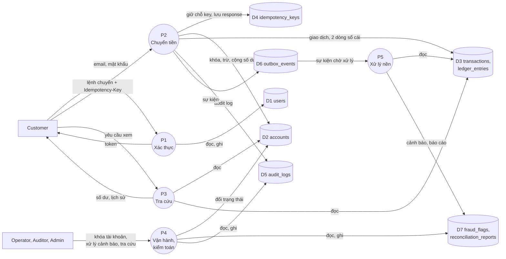
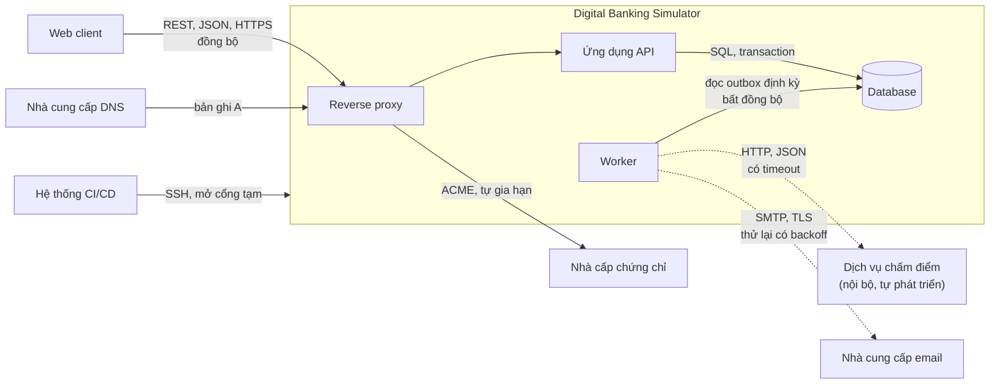
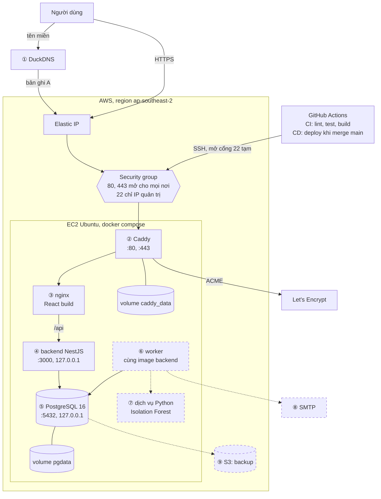

# Kiến trúc hệ thống

Tên hệ thống: **Digital Banking Simulator**. Tài liệu theo khung System Architecture của môn học, gồm 10 mục.

Cách đọc: mục 2 đến mục 6 mô tả hệ thống bằng **vai trò và khái niệm**, chưa gắn công nghệ. Công nghệ và hạ tầng cụ thể nằm ở mục 7, mỗi lựa chọn trỏ về ADR giải thích lý do.

Ký hiệu tình trạng: **Có** là đã chạy trên `main`; **Review** là đang ở pull request; **Dự kiến** kèm tuần trong kế hoạch.

## 1. Tổng quan hệ thống

| Câu hỏi | Trả lời |
|---|---|
| Mục đích | Backend ngân hàng số mô phỏng cho thao tác tài khoản và chuyển tiền nội bộ. Chỉ mô phỏng, không có giao dịch tài chính thật |
| Người dùng | Customer, Operator, Auditor, Admin. Nhu cầu từng vai trò: [BRD](../brd/README.md), mục 3 |
| Mục tiêu nghiệp vụ | Tiền không sai, không trừ hai lần, phân quyền chặt, mọi thao tác truy vết được, vận hành được trên cloud ([BRD](../brd/README.md), mục 2) |
| Thành phần cốt lõi | Ứng dụng API chia module, một database giao dịch, worker chạy nền, giao diện web (mục 2) |
| Ràng buộc | Nhóm 5 người, 10 tuần, ngân sách dưới 30 USD mỗi tháng. Tiền dùng số thập phân chính xác, không dùng số thực ([SRS](../srs/README.md), mục 3) |
| Hiệu năng, mở rộng | Khoảng 12 request/giây giờ cao điểm, thiết kế cho 5 lần mức đó. Đọc nhiều, ghi ít nhưng phải đúng tuyệt đối. Điểm nóng là nhiều người cùng chuyển vào một tài khoản ([BRD](../brd/README.md), mục 4) |

**Các NFR quan trọng nhất là nhất quán và bảo mật.** Cả 3 tình huống lỗi của đề (trừ xong nhưng cộng lỗi, client timeout rồi gửi lại, service chết giữa giao dịch) đều thuộc về nhất quán. Mỗi NFR được đảm bảo bằng thành phần nào, đo bằng metric nào: [SRS, mục 5](../srs/README.md#5-truy-vết-nfr-cơ-chế-metric-demo).

## 2. Kiến trúc ứng dụng

### Sơ đồ logic

Khung nét đứt là thành phần dự kiến.

| # | Thành phần | Trách nhiệm | Tình trạng |
|---|---|---|---|
| ① | DNS | Trỏ tên miền về địa chỉ máy chủ | Có |
| ② | Reverse proxy | Điểm vào duy nhất từ Internet. Kết thúc HTTPS, chuyển HTTP sang HTTPS, chuyển `/api` vào ứng dụng | Có |
| ③ | Web client | Giao diện cho 4 vai trò. Gọi API cùng tên miền nên không cần CORS | Có. Màn hình Operator, Auditor: tuần 8 |
| ④ | Ứng dụng API | Toàn bộ nghiệp vụ, chia module theo capability. Không giữ trạng thái giữa các request | Có |
| ⑤ | Database giao dịch | Nguồn dữ liệu duy nhất, đảm bảo ACID. Kiêm hàng đợi sự kiện (bảng outbox), không dùng message broker riêng | Có. Bảng outbox: Review (#14) |
| ⑥ | Worker | Process riêng, cùng codebase với API. Lấy sự kiện từ outbox, chạy việc định kỳ | Dự kiến tuần 8. Đối soát, quét giao dịch treo: Review (#15) |
| ⑦ | Dịch vụ chấm điểm rủi ro | Chấm điểm giao dịch bằng mô hình học máy, chỉ để gắn cờ | Dự kiến tuần 11 |
| ⑧ | Dịch vụ email | Gửi cảnh báo giao dịch bị gắn cờ tới Operator, Auditor, Admin | Dự kiến, chờ phân công |
| ⑨ | Kho backup | Lưu bản sao database ở ngoài máy chủ | Dự kiến tuần 9 |
| ⑩ | Giám sát | Dashboard 4 golden signals, SLO, cảnh báo | Dự kiến tuần 10 |

### Cấu trúc ứng dụng

**Modular monolith** ([ADR 001](../adr/001-modular-monolith.md)): một ứng dụng chia module rõ ràng, dùng một database ([ADR 002](../adr/002-postgresql.md)). Việc cần kết quả ngay chạy trong request; việc nền chạy ở worker ([ADR 003](../adr/003-dong-bo-va-bat-dong-bo.md)).

Vì sao không tách microservice: chuyển tiền phải trừ, cộng và ghi sổ cái nguyên tử. Tách ra nhiều service thì mất transaction của database, phải dùng saga và chấp nhận nhất quán sau, điều này không phù hợp với số dư ngân hàng. Quy mô 5 người và 12 request/giây cũng chưa cần scale riêng từng phần.

| Module | Capability | Bảng chính | Phụ trách | Tình trạng |
|---|---|---|---|---|
| `auth`, `users` | Đăng ký, đăng nhập, vai trò, khóa user | `users` | TV2 | Có |
| `accounts` | Số dư, tạo tài khoản khi đăng ký, tra cứu người nhận, khóa và mở tài khoản | `accounts` | TV3, F3 do TV2 | Có |
| `transactions` | Chuyển tiền, Idempotency-Key, sổ cái kép, lịch sử, giao dịch `failed` | `transactions`, `ledger_entries`, `idempotency_keys` | TV3 | Có |
| `audit` | Ghi và tra cứu audit log. Module khác gọi `AuditService` | `audit_logs` | TV2 | Có |
| `outbox` | Ghi sự kiện trong transaction của nghiệp vụ | `outbox_events` | TV3 | Review (#14) |
| `reconciliation` | Đối soát số dư với sổ cái, quét giao dịch treo | `reconciliation_reports` | TV1 | Review (#15) |
| worker | Process nền: lấy sự kiện, chạy luật bất thường, gọi việc định kỳ | `outbox_events` | TV3 | Dự kiến tuần 8 |
| `fraud` | Luật bất thường, API để Operator xử lý cảnh báo | `fraud_flags` | TV3 | Dự kiến tuần 8 |
| `health` | Kiểm tra ứng dụng và kết nối database | | TV5 | Có |
| `common`, `database` | Định dạng lỗi, `requestId`, migration, seed | | TV1 | Có |

**Quy tắc ranh giới:** module gọi nhau qua service được export, không truy vấn thẳng bảng của module khác, trừ khi thao tác phải nằm trong cùng DB transaction với nghiệp vụ. Hiện có hai ngoại lệ: `transactions` khóa và cập nhật số dư trên bảng `accounts`; `AuthService.register` ghi thẳng bảng `users` khi tạo user kèm tài khoản. Ranh giới module giúp sau này tách worker hay fraud ra service riêng mà không phải sửa nghiệp vụ.

### Xử lý lỗi và log

- Mọi lỗi trả cùng định dạng `{ code, message, requestId, details? }`. Bảng mã lỗi: [api.md](../api.md).
- Mỗi request có `requestId`, nằm trong header `X-Request-Id`, body của lỗi và audit log. Client tự gửi được header này để tra log.
- Log ứng dụng ghi ra stdout, container giữ log. Lỗi không lường trước được log kèm `requestId`.

| Lỗi | Hệ thống phản ứng thế nào |
|---|---|
| Lỗi giữa lúc trừ và cộng tiền | Rollback cả transaction |
| Client gửi lại do timeout | Idempotency-Key trả lại kết quả cũ, không trừ tiền lần hai |
| Ứng dụng chết giữa transaction | Database tự rollback phần chưa commit. Job quét giao dịch treo là lớp phòng thủ thêm |
| Ứng dụng chết sau commit, trước khi xử lý sự kiện | Sự kiện vẫn nằm trong outbox, worker xử lý khi chạy lại |
| Worker chết | Sự kiện chờ trong outbox, chuyển tiền không bị ảnh hưởng |
| Dịch vụ chấm điểm lỗi hoặc chậm | Worker chỉ dùng luật cố định |
| Dịch vụ email lỗi | Cảnh báo vẫn nằm trong database, worker thử lại có backoff |
| Hai lệnh chuyển cùng lúc | Khóa dòng theo thứ tự cố định, lệnh sau chờ lệnh trước, không deadlock |
| Database không phản hồi | Health check trả `503`, container bị đánh dấu không khỏe |
| Lộ mật khẩu database của ứng dụng | User của ứng dụng không sửa, xóa được sổ cái, audit log, báo cáo đối soát |

## 3. Danh sách tính năng

Đặc tả từng use case: [FRS](../frs/README.md). Phân công và tiến độ: [phase2/task.md](../phase2/task.md).

| Tính năng | Vai trò | UC | Phục vụ mục tiêu | Tình trạng |
|---|---|---|---|---|
| Đăng ký, đăng nhập, tự tạo tài khoản | Customer | UC1 | Phân quyền | Có |
| Xem số dư | Customer | UC2 | | Có |
| Chuyển tiền nội bộ, chống gửi trùng | Customer | UC3 | Tiền không sai, không trừ hai lần | Có |
| Lịch sử, trạng thái giao dịch, kể cả giao dịch lỗi | Customer | UC4, UC5 | Truy vết | Có |
| Khóa, mở tài khoản ngân hàng | Operator | UC1 | Phân quyền | Có |
| Khóa, mở user | Admin | UC1 | Phân quyền | Có |
| Tra cứu audit log | Auditor, Admin | UC6 | Truy vết | Có |
| Đối soát, báo cáo đối soát | Auditor, Admin | | Tiền không sai | Review (#15) |
| Phát hiện giao dịch đáng ngờ, Operator xử lý cảnh báo | Operator | UC7 | Truy vết | Dự kiến tuần 8 |
| Chấm điểm rủi ro bằng học máy | Hệ thống | UC7 | | Dự kiến tuần 11 |
| Rate limit, khóa đăng nhập sai nhiều lần | Hệ thống | | Phân quyền | Dự kiến tuần 9 |
| Nạp tiền mô phỏng | Operator | UC1 | | Chưa có người làm |

**Tính năng phụ trợ:** quét giao dịch treo, health check, audit log tự động cho mọi thao tác thay đổi dữ liệu.

**Ngoài phạm vi:** giao dịch tài chính thật, chuyển liên ngân hàng, đa tiền tệ, ứng dụng mobile, eKYC. **Làm thêm nếu còn thời gian:** hạn mức theo ngày, refresh token, OTP, hoàn tiền.

## 4. Luồng dữ liệu

### Mức tổng quát (context)

### Mức chi tiết: tiến trình và kho dữ liệu

P2 ghi vào D2, D3, D4, D5, D6 trong **một DB transaction**: hoặc tất cả cùng có, hoặc không có gì. Các bước chi tiết ở [sequence-chuyen-tien.md](../sequence-chuyen-tien.md):

1. Client gửi lệnh kèm token và `Idempotency-Key` sinh khi mở form.
2. Mở transaction. Giữ chỗ key bằng `INSERT ... ON CONFLICT DO NOTHING`. Key đã có và cùng nội dung thì trả lại kết quả cũ, kể cả lỗi `422` đã lưu. Khác nội dung thì `409`.
3. Khóa hai tài khoản theo thứ tự số tài khoản ([ADR 004](../adr/004-khoa-bi-quan.md)).
4. Kiểm tra: tài khoản nguồn thuộc user, hai bên đang hoạt động, đủ số dư.
5. Cập nhật số dư bằng phép tính trong database, ghi giao dịch, 2 dòng sổ cái, audit log, sự kiện, lưu response vào key.
6. Commit. Database kiểm tra lúc commit: giao dịch hoàn tất phải có đúng 1 dòng debit và 1 dòng credit cân nhau ([ADR 005](../adr/005-so-cai-kep.md)). Lỗi ở bất kỳ bước nào thì rollback toàn bộ.

Lỗi nghiệp vụ (không đủ số dư, tài khoản bị khóa) được lưu thành giao dịch `failed` trong một transaction riêng, sau khi đã rollback.

| Câu hỏi | Trả lời |
|---|---|
| Nguồn và đích dữ liệu | Người dùng nhập qua web client. Mọi dữ liệu lưu ở database giao dịch, một nguồn duy nhất |
| Đường đi quan trọng nhất | P2 chuyển tiền. Bottleneck dự kiến là **khóa dòng trên tài khoản nóng** và số kết nối database. CPU của ứng dụng ít khả năng là giới hạn. Sẽ đo ở load test tuần 10 |
| Giao thức, định dạng | JSON qua HTTPS. Số tiền luôn truyền dạng chuỗi, lưu `numeric(18,2)`, không dùng số thực |
| Kiểm tra dữ liệu | Hai lớp: validate DTO ở ứng dụng (trả `400`); ràng buộc trong database là lớp cuối (số dư thường không âm, số tiền dương, số tài khoản 12 chữ số, sổ cái cân) |
| Đảm bảo nhất quán | Một transaction cho mỗi lệnh chuyển, sổ cái kép, sổ cái và audit log chỉ thêm dòng, đối soát hằng ngày ([sequence-doi-soat.md](../sequence-doi-soat.md)) |

## 5. Kiến trúc tích hợp

| Hệ thống | Kiểu tích hợp | Giao thức | Đồng bộ | Bảo mật | Giám sát | Khi lỗi | Tình trạng |
|---|---|---|---|---|---|---|---|
| Web client | API | REST, JSON, HTTPS | Đồng bộ | Token Bearer, HTTPS | Health check, log có `requestId` | Trả lỗi theo định dạng chung, client hiển thị | Có |
| Worker với database | Hàng đợi trong database (outbox) | SQL, `FOR UPDATE SKIP LOCKED` | Bất đồng bộ | User DB riêng, quyền tối thiểu | Số sự kiện `pending`, `failed` | Thử lại có backoff, quá số lần thì `failed` | Review (#14), worker tuần 8 |
| Dịch vụ chấm điểm | API nội bộ | HTTP, JSON trong mạng nội bộ | Worker gọi đồng bộ, có timeout | Không mở ra Internet | Tỷ lệ lỗi, latency | Chỉ dùng luật cố định, không chặn chuyển tiền | Dự kiến tuần 11 |
| Nhà cung cấp email | Gửi thư | SMTP, TLS | Bất đồng bộ | Thông tin đăng nhập SMTP để ngoài repo | Số thư gửi lỗi | Cảnh báo vẫn trong database, thử lại sau | Dự kiến |
| Nhà cấp chứng chỉ | Cấp, gia hạn chứng chỉ | ACME | Bất đồng bộ, tự động | | Log của reverse proxy | Chứng chỉ cũ còn hạn 90 ngày, đủ thời gian xử lý | Có |
| Nhà cung cấp DNS | Phân giải tên miền | DNS | | | Uptime check từ bên ngoài | IP tĩnh nên bản ghi không đổi | Có |
| Hệ thống CI/CD | Deploy | SSH, API của cloud | Chạy khi merge `main` | Cổng SSH chỉ mở tạm cho máy chạy CI, quyền cloud tối thiểu | Kết quả workflow | Deploy tay bằng một lệnh | Đang làm |

**Đồng bộ dữ liệu giữa các thành phần:** chỉ có một database, nên không phải đồng bộ dữ liệu giữa nhiều nơi. Worker và dịch vụ chấm điểm chỉ đọc dữ liệu đã commit và ghi kết quả của riêng mình.

### Việc nào đồng bộ, việc nào bất đồng bộ

| Việc | Cách chạy | Lý do |
|---|---|---|
| Đăng nhập, xem số dư, lịch sử | Đồng bộ | Người dùng cần kết quả ngay |
| Chuyển tiền: khóa, trừ, cộng, sổ cái, idempotency, audit, sự kiện | Đồng bộ, **một DB transaction** | Phải nhất quán mạnh |
| Lưu giao dịch `failed` | Đồng bộ, transaction riêng sau rollback | Giữ lại lý do lỗi mà không ảnh hưởng rollback |
| Phát hiện bất thường | Bất đồng bộ qua outbox. Xử lý lại không tạo cảnh báo trùng | Không làm chậm chuyển tiền, không mất sự kiện khi crash ([ADR 007](../adr/007-outbox-postgresql.md)) |
| Chấm điểm rủi ro | Bất đồng bộ, worker gọi | Chỉ gắn cờ, không chặn chuyển tiền |
| Đối soát | Bất đồng bộ, mỗi ngày | Việc nặng, không cần ngay |
| Quét giao dịch treo | Bất đồng bộ, mỗi 5 phút | Xử lý tình huống service chết giữa chừng |
| Gửi email cảnh báo | Bất đồng bộ | Lỗi email không ảnh hưởng nghiệp vụ |

## 6. Giao diện

Mọi API dùng JSON, xác thực bằng token Bearer, lỗi theo định dạng chung. Request, response chi tiết: [api.md](../api.md). Thời gian phản hồi mục tiêu: [SRS](../srs/README.md), mục 1.

| # | Endpoint | Mục đích | Giao thức | Hệ thống gọi | Chiều | Gateway | Đồng bộ | Tần suất | Hạ tầng mạng | Ghi chú |
|---|---|---|---|---|---|---|---|---|---|---|
| 1 | `POST /api/auth/register`, `POST /api/auth/login` | Đăng ký, đăng nhập | HTTPS, JSON | Web client | Vào | Reverse proxy | Đồng bộ | Theo yêu cầu | Internet, cổng 443 | Công khai. Rate limit tuần 9 |
| 2 | `GET /api/auth/me` | Thông tin user đang đăng nhập | HTTPS, JSON | Web client | Vào | Reverse proxy | Đồng bộ | Mỗi lần mở app | Internet, cổng 443 | |
| 3 | `GET /api/accounts/me`, `GET /api/accounts/lookup/:accountNumber` | Số dư, tra cứu tên người nhận | HTTPS, JSON | Web client | Vào | Reverse proxy | Đồng bộ | Theo yêu cầu | Internet, cổng 443 | Tra cứu chỉ trả tên, không trả số dư |
| 4 | `POST /api/transactions/transfer` | Chuyển tiền | HTTPS, JSON | Web client | Vào | Reverse proxy | Đồng bộ | Khoảng 10.000 lệnh mỗi ngày | Internet, cổng 443 | Bắt buộc header `Idempotency-Key` |
| 5 | `GET /api/transactions`, `GET /api/transactions/:id` | Lịch sử, trạng thái giao dịch | HTTPS, JSON | Web client | Vào | Reverse proxy | Đồng bộ | Theo yêu cầu | Internet, cổng 443 | Giao dịch của người khác trả `404` |
| 6 | `PATCH /api/operator/accounts/:id/status` | Khóa, mở tài khoản | HTTPS, JSON | Web client (Operator) | Vào | Reverse proxy | Đồng bộ | Hiếm | Internet, cổng 443 | Ghi audit log |
| 7 | `GET`, `PATCH /api/operator/fraud-flags` | Xem, xử lý cảnh báo | HTTPS, JSON | Web client (Operator) | Vào | Reverse proxy | Đồng bộ | Theo yêu cầu | Internet, cổng 443 | Dự kiến tuần 8 |
| 8 | `GET /api/audit-logs` | Tra cứu audit log | HTTPS, JSON | Web client (Auditor) | Vào | Reverse proxy | Đồng bộ | Theo yêu cầu | Internet, cổng 443 | Chỉ đọc |
| 9 | `POST /api/reconciliation/run`, `GET /api/reconciliation/reports` | Chạy, xem đối soát | HTTPS, JSON | Web client (Admin, Auditor) | Vào | Reverse proxy | Đồng bộ | Hằng ngày | Internet, cổng 443 | Review (#15) |
| 10 | `GET /api/admin/users`, `PATCH /api/admin/users/:id/status` | Quản lý user | HTTPS, JSON | Web client (Admin) | Vào | Reverse proxy | Đồng bộ | Hiếm | Internet, cổng 443 | |
| 11 | `GET /api/health` | Kiểm tra ứng dụng và database | HTTP, JSON | Container runtime, uptime check | Vào | Không qua gateway khi kiểm tra trong máy | Đồng bộ | Mỗi 10 giây | Mạng nội bộ của máy | DB lỗi thì `503` |
| 12 | Dịch vụ chấm điểm | Lấy điểm rủi ro của giao dịch | HTTP, JSON | Worker | Ra | Không | Đồng bộ, có timeout | Mỗi giao dịch | Mạng nội bộ của máy | Dự kiến tuần 11 |
| 13 | Máy chủ SMTP | Gửi email cảnh báo | SMTP, TLS | Worker | Ra | Không | Bất đồng bộ | Khi có cảnh báo | Internet | Dự kiến |
| 14 | Nhà cấp chứng chỉ | Xin, gia hạn chứng chỉ HTTPS | ACME | Reverse proxy | Ra | Không | Bất đồng bộ | Khoảng 60 ngày một lần | Internet, cổng 80 để xác minh | |
| 15 | SSH vào máy chủ | Deploy bản mới | SSH | Hệ thống CI/CD | Vào | Không | Đồng bộ | Mỗi lần merge `main` | Internet, cổng 22 chỉ mở tạm | Đang làm |

## 7. Kiến trúc triển khai

Mục này gắn các vai trò ở mục 2 với hạ tầng và công nghệ cụ thể. Lý do chọn: [ADR 006](../adr/006-deploy-ec2-docker-compose.md). Các bước deploy: [infra/README.md](../../infra/README.md). Phụ trách: TV5.

### Vai trò và công nghệ

| # | Vai trò (mục 2) | Công nghệ | Lý do | Tình trạng |
|---|---|---|---|---|
| ① | DNS | DuckDNS, Elastic IP | Miễn phí. IP tĩnh để Let's Encrypt cấp chứng chỉ | Có |
| ② | Reverse proxy | Caddy | Tự xin, gia hạn chứng chỉ HTTPS, cấu hình ngắn | Có |
| ③ | Web client | React, Vite, phục vụ bằng nginx | nginx chuyển `/api` sang backend nên không cần CORS | Có |
| ④ | Ứng dụng API | NestJS 12, TypeScript, TypeORM | Hỗ trợ module, guard, validate, Swagger | Có |
| ⑤ | Database | PostgreSQL 16 | Transaction, khóa dòng, ràng buộc, trigger ([ADR 002](../adr/002-postgresql.md)). Hàng đợi bằng bảng outbox ([ADR 007](../adr/007-outbox-postgresql.md)) | Có |
| ⑥ | Worker | Process Node.js, cùng image với backend | Dùng lại code nghiệp vụ ([ADR 003](../adr/003-dong-bo-va-bat-dong-bo.md)) | Dự kiến tuần 8 |
| ⑦ | Chấm điểm rủi ro | Python, Isolation Forest | Hệ sinh thái học máy. Lý do không dùng LLM: ADR 008, tuần 11 | Dự kiến tuần 11 |
| ⑧ | Email | Nodemailer, SMTP | | Dự kiến |
| ⑨ | Backup | S3 | Lưu ngoài máy chủ, rẻ | Dự kiến tuần 9 |
| ⑩ | Giám sát | Chưa chốt | | Dự kiến tuần 10 |
| | Đóng gói, CI/CD | Docker, docker compose, GitHub Actions | Chạy local và server giống nhau bằng một lệnh | CI có. CD đang làm |

### Trả lời các câu hỏi về triển khai

| Câu hỏi | Trả lời |
|---|---|
| Triển khai ở đâu | AWS, một máy EC2 chạy docker compose |
| Môi trường | Local: docker compose trên máy dev. CI: database tạm cho mỗi lần chạy test. Production: EC2. **Không có staging** vì ngân sách; mọi thay đổi phải qua CI và review trước khi vào `main` |
| Mô hình | Một máy, nhiều container. Chỉ Caddy mở cổng ra ngoài, các container khác chỉ nghe ở `127.0.0.1` hoặc mạng nội bộ của docker |
| Công cụ | Docker, docker compose, GitHub Actions, Caddy. Terraform cho hạ tầng: tuần 9 |
| Sẵn sàng cao | Chưa có dự phòng. Container tự khởi động lại khi chết, health check có kiểm tra database. Sự cố mất máy xử lý bằng khôi phục (mục 9). Mục tiêu 99,5% vẫn đạt được với cách này ([SRS, mục 5](../srs/README.md#5-truy-vết-nfr-cơ-chế-metric-demo)) |
| Cách scale | Trước mắt scale dọc: đổi máy lớn hơn. Ứng dụng API stateless nên khi cần có thể thêm máy sau load balancer. Lưu ý chỗ nghẽn dự kiến là khóa tài khoản nóng trong database, thêm máy ứng dụng không giải quyết được |
| Cập nhật bản mới | Hiện tại deploy tay: `git pull && docker compose up -d --build`, migration tự chạy khi backend khởi động. Khi nhánh tự động deploy được merge: merge `main` và CI xanh thì GitHub Actions tự làm các bước trên rồi kiểm tra `/api/health`. Đây là kiểu Recreate, có vài giây gián đoạn |
| Khi deploy lỗi | Deploy lại commit trước đó. Migration phải tương thích ngược (thêm cột trước, xóa cột sau) để bản cũ vẫn chạy được với schema mới. Backup trước khi chạy migration lớn |

### Những gì cố ý chưa có

Kiến trúc baseline thường có load balancer, CDN, WAF, nhiều zone. Nhóm chưa dùng, vì lý do sau:

| Thành phần | Vì sao chưa cần | Khi nào thêm |
|---|---|---|
| Load balancer, nhiều máy ứng dụng | 60 request/giây một máy đáp ứng được. Chỗ nghẽn dự kiến nằm ở database | Load test cho thấy CPU ứng dụng là giới hạn, hoặc cần lên 99,9% |
| Database managed nhiều zone | Đắt hơn ngân sách. Backup và khôi phục đủ cho mục tiêu 1 giờ dữ liệu, 30 phút khôi phục | Cần sẵn sàng cao hơn 99,5% |
| CDN, WAF | Giao diện nhỏ, người dùng trong nước. Rate limit ở ứng dụng (tuần 9) chặn lạm dụng cơ bản | Có người dùng thật, bị tấn công |
| Message broker riêng | Outbox trong database đủ cho lượng sự kiện này, lại không mất sự kiện khi crash ([ADR 007](../adr/007-outbox-postgresql.md)) | Lượng sự kiện quá lớn so với database |
| Cache | Số dư phải nhất quán mạnh, không cache được. Lịch sử đọc trực tiếp vẫn nhanh | Load test cho thấy đọc lịch sử là chỗ chậm |
| Kubernetes | Một máy, vài container. Kubernetes thêm phức tạp vận hành mà không giải quyết vấn đề nào của nhóm | |

Hướng nâng cấp khi cần: database chuyển sang RDS nhiều zone, frontend sang S3 và CloudFront, backend và worker sang ECS Fargate sau load balancer. Kiến trúc module không phải đổi.

## 8. Bảo mật

| Câu hỏi | Trả lời |
|---|---|
| Xác thực | Email và mật khẩu, mật khẩu băm bằng bcrypt cost 12. Token JWT hết hạn sau 15 phút. Mỗi request kiểm tra lại trạng thái user trong database, nên khóa user có hiệu lực ngay. Đăng nhập sai không cho biết email có tồn tại hay không |
| Mã hóa | In transit: HTTPS từ người dùng tới reverse proxy, HTTP chỉ chạy bên trong máy. At rest: bật mã hóa ổ đĩa EBS, tuần 9 |
| Phân quyền | RBAC theo 4 vai trò, kiểm tra ở guard. Kiểm tra chủ sở hữu ở tầng nghiệp vụ. Dữ liệu của người khác trả `404`, không để lộ là có tồn tại |
| Tích hợp bên thứ ba | Deploy: SSH key riêng, cổng 22 chỉ mở tạm cho máy chạy CI, user cloud chỉ có quyền sửa đúng một security group. Thông tin đăng nhập SMTP để ngoài repo |
| Log và audit trail | Audit log cho mọi thao tác thay đổi dữ liệu, ghi trong cùng transaction với thao tác. Không ghi mật khẩu, token. Audit log và sổ cái không sửa, xóa được, kể cả bằng user của ứng dụng |
| Tiêu chuẩn tuân thủ | Hệ thống mô phỏng, không áp dụng tiêu chuẩn chính thức. Nhóm theo các nguyên tắc: OWASP Top 10, quyền tối thiểu, phòng thủ nhiều lớp. Threat model: tuần 9 |

| Lớp | Biện pháp |
|---|---|
| Mạng | Chỉ mở 80, 443. Cổng SSH chỉ mở cho IP quản trị. Database và backend không mở ra Internet |
| Xác thực | Token ngắn hạn, kiểm tra trạng thái user mỗi request |
| Phân quyền | Guard theo vai trò, kiểm tra chủ sở hữu, trả `404` |
| Dữ liệu | Hai user database: owner chỉ dùng cho migration; ứng dụng dùng user có quyền tối thiểu. Trigger chặn sửa, xóa sổ cái và audit log |
| Secret | Không nằm trong repo. Trên server để trong `.env`. Có chuyển sang dịch vụ quản lý secret hay không: chốt tuần 9 |
| Truy vết | `requestId` trong mọi response, lỗi và audit log |
| Lạm dụng | Rate limit đăng nhập và chuyển tiền, tạm khóa khi đăng nhập sai nhiều lần (tuần 9) |

## 9. Sao lưu và khôi phục

Mục tiêu: mất tối đa 1 giờ dữ liệu (RPO), khôi phục trong 30 phút (RTO) ([SRS](../srs/README.md), mục 1). Cách làm cụ thể do TV5 chốt ở tuần 9. Dưới đây là phương án dự kiến.

| Câu hỏi | Trả lời |
|---|---|
| Cần backup gì | Database: toàn bộ dữ liệu nghiệp vụ. File `.env` trên server: lưu riêng, an toàn, không vào repo. Code đã ở GitHub. Chứng chỉ HTTPS không cần backup, mất thì xin lại |
| Tần suất | Mỗi giờ, để đạt RPO 1 giờ |
| Lưu ở đâu | S3, ngoài máy chủ, để mất máy vẫn còn backup |
| Công cụ | `pg_dump` chạy định kỳ rồi đẩy lên S3, hoặc snapshot ổ đĩa EBS theo lịch. Chốt ở tuần 9 |
| Chiến lược DR | Backup & Restore, mức rẻ nhất. Không dự phòng nóng |
| Quy trình khôi phục | 1. Dựng máy mới theo `infra/README.md` hoặc Terraform. 2. Lấy code, đặt `.env`. 3. Nạp backup mới nhất vào database. 4. Chạy đối soát để xác nhận dữ liệu khớp. 5. Trỏ IP tĩnh về máy mới |
| Kiểm tra backup | Diễn tập khôi phục ở tuần 9, đo thời gian thật. Backup chưa từng khôi phục thử thì coi như chưa có backup |
| Sự cố lớn | Mất cả region thì dựng lại ở region khác từ code và backup. Chấp nhận thời gian lâu hơn RTO, vì đây là hệ thống mô phỏng |

Dữ liệu ghi dở do ứng dụng chết giữa chừng không cần khôi phục từ backup: database rollback phần chưa commit, job quét giao dịch treo xử lý phần còn lại, đối soát kiểm tra lại toàn bộ ([sequence-doi-soat.md](../sequence-doi-soat.md)).

## 10. Thuật ngữ

| Thuật ngữ | Nghĩa |
|---|---|
| Idempotency-Key | Mã client gửi kèm lệnh chuyển tiền. Gửi lại cùng mã thì nhận lại kết quả cũ, không tạo giao dịch mới |
| Sổ cái kép | Mỗi giao dịch ghi 2 dòng: một dòng trừ (debit) ở tài khoản gửi, một dòng cộng (credit) ở tài khoản nhận, cùng số tiền |
| Tài khoản hệ thống | Tài khoản `000000000000`, nguồn tiền khi nạp tiền, được phép âm. Nhờ nó, tổng số dư toàn hệ thống luôn bằng 0 |
| Outbox | Bảng lưu sự kiện, ghi cùng transaction với nghiệp vụ. Worker đọc sau, nên sự kiện không mất khi ứng dụng chết |
| Đối soát | Kiểm tra số dư có khớp với sổ cái không và tổng số dư có bằng 0 không |
| Giao dịch treo | Giao dịch nằm ở trạng thái `processing` quá 15 phút |
| Modular monolith | Một ứng dụng triển khai chung, bên trong chia module có ranh giới rõ |
| Khóa bi quan | Khóa dòng dữ liệu trước khi sửa (`SELECT ... FOR UPDATE`), lệnh khác phải chờ |
| `SKIP LOCKED` | Bỏ qua dòng đang bị khóa thay vì chờ, dùng để nhiều worker cùng lấy việc không trùng nhau |
| RBAC | Phân quyền theo vai trò |
| RPO, RTO | Lượng dữ liệu tối đa được phép mất, và thời gian tối đa để khôi phục |
| SLO | Mục tiêu nội bộ về chất lượng dịch vụ, ví dụ 99,5% thời gian hoạt động mỗi tháng |
| p95 | 95% request nhanh hơn giá trị này |
| Reverse proxy | Máy chủ đứng trước ứng dụng, nhận request từ Internet rồi chuyển vào trong |
