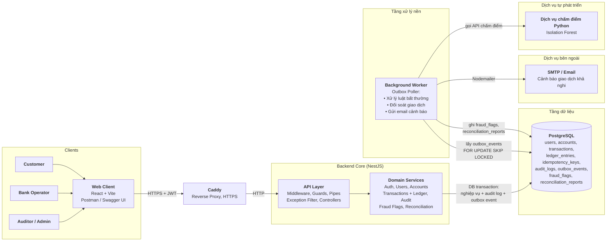
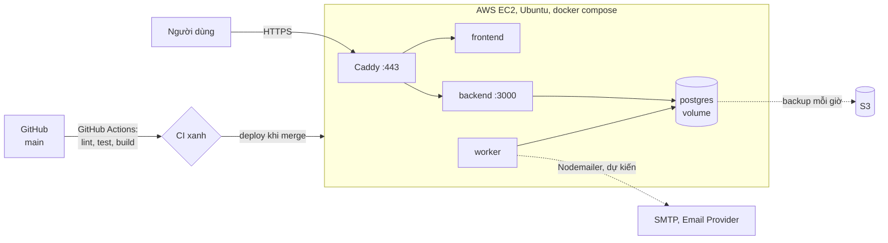

# Kiến trúc hệ thống

Yêu cầu: [BRD](../brd/README.md), [SRS](../srs/README.md), [FRS](../frs/README.md). Lý do của từng lựa chọn: [adr/](../adr/).

## 1. Tổng quan

Kiến trúc nhiều tầng (N-tier) theo mô hình **modular monolith** (ADR 001): một backend NestJS chia module rõ ràng, dùng một PostgreSQL (ADR 002). Việc cần kết quả ngay chạy đồng bộ trong request; việc nền chạy ở một worker cùng codebase (ADR 003).

Tầng xử lý nền theo mẫu **Transactional Outbox** (ADR 007): chuyển tiền thành công ghi sự kiện vào `outbox_events` trong cùng DB transaction, worker định kỳ lấy sự kiện bằng `SELECT ... FOR UPDATE SKIP LOCKED`. Không dùng Redis hay Kafka: đẩy job sang hàng đợi ngoài sau khi commit có thể mất sự kiện nếu backend chết giữa chừng, và hệ thống có ít thành phần phải vận hành hơn.

Phần đã chạy trên `main`: backend (Auth, Users, Accounts, Transactions và sổ cái, Audit, Health), PostgreSQL. Lưu giao dịch `failed` và audit log của chuyển tiền (F4), React SPA đang ở nhánh riêng, chưa merge. Phần còn lại theo lịch: Caddy tuần 6; worker, Fraud, Reconciliation tuần 8; backup tuần 9; dịch vụ Python tuần 11. Gửi email là dự kiến, chờ bổ sung vào phân công.

### Các thành phần

| Thành phần | Công nghệ | Trách nhiệm chính |
|---|---|---|
| Clients | Web SPA (React, Vite), Postman, Swagger UI | Gửi request HTTPS kèm JWT Bearer token, đóng vai Customer, Bank Operator, Auditor hoặc Admin. Giao diện chặn trang theo vai trò |
| Reverse Proxy | Caddy trên EC2 | Kết thúc HTTPS, chuyển request tới backend |
| API Layer | NestJS Controllers, `RequestIdMiddleware`, `JwtAuthGuard`, `RolesGuard`, `ValidationPipe`, `HttpExceptionFilter` | Nhận request, gắn `requestId`, xác thực JWT, phân quyền RBAC, validate DTO, chuẩn hóa lỗi về dạng `{ code, message, requestId, details? }` |
| Domain Services | NestJS Services của các module ở mục 2 | Thực thi nghiệp vụ: đăng ký, khóa và mở user, tài khoản, số dư. Chuyển tiền trong 1 DB transaction có Idempotency-Key, khóa bi quan theo thứ tự cố định, sổ cái kép. Ghi audit log trong transaction của thao tác. Operator xử lý cảnh báo, Auditor và Admin xem báo cáo đối soát |
| Background Worker | Process Node.js riêng (`node dist/worker.js`), cùng codebase | Lấy sự kiện từ `outbox_events`, thử lại có backoff, quá số lần thì đánh dấu `failed`. Chấm luật bất thường, không chặn chuyển tiền. Đối soát mỗi ngày. Gửi email cảnh báo |
| Dịch vụ chấm điểm (tuần 11) | Python, Isolation Forest | Chấm điểm rủi ro cho worker, chỉ phục vụ gắn cờ |
| Data Layer | PostgreSQL 16 qua TypeORM | Nguồn dữ liệu duy nhất, đồng thời làm hàng đợi. `ledger_entries`, `audit_logs` chỉ thêm dòng. Backend kết nối bằng user DB riêng `bank_app` |
| External Service (dự kiến) | SMTP, Email Provider (Nodemailer) | Nhận lệnh gửi email từ worker khi có giao dịch bị gắn cờ, gửi tới Operator, Auditor và Admin |

## 2. Các module

| Module | Trách nhiệm | Bảng chính | Phụ trách |
|---|---|---|---|
| `auth`, `users` | Đăng ký, đăng nhập JWT, guard, vai trò, khóa user | `users` | TV2 |
| `accounts` | Số dư, tạo tài khoản khi đăng ký, khóa và mở tài khoản ngân hàng | `accounts` | TV3, F3 do TV2 |
| `transactions` | Chuyển tiền, Idempotency-Key, ghi sổ cái kép, lịch sử | `transactions`, `ledger_entries`, `idempotency_keys` | TV3 |
| `audit` | Ghi và tra cứu audit log, module khác gọi `AuditService` | `audit_logs` | TV2 |
| worker (tuần 8) | Process nền: lấy sự kiện từ outbox, chạy luật bất thường và đối soát, gửi email (chờ phân công) | `outbox_events` (`transactions` ghi, worker đọc) | TV3 |
| `fraud` (tuần 8) | Luật phát hiện bất thường chạy ở worker, API cho Operator xem và xử lý cảnh báo | `fraud_flags` | TV3 |
| `reconciliation` (tuần 8) | Đối soát số dư với sổ cái | `reconciliation_reports` | TV1 |
| `health` | Kiểm tra app và DB | | TV5 |
| `common`, `database` | Định dạng lỗi, requestId, migration, seed | | TV1 |

**Quy tắc ranh giới:** module gọi nhau qua service được export (ví dụ `AccountsService`, `AuditService`), không truy vấn thẳng bảng của module khác, trừ thao tác phải nằm trong cùng DB transaction với nghiệp vụ. Hiện có hai ngoại lệ: `transactions` khóa và cập nhật số dư trên bảng `accounts`, `AuthService.register` ghi thẳng bảng `users` khi tạo user kèm tài khoản. Tất cả dùng chung một DB để chuyển tiền giữ được ACID; ranh giới module giúp sau này tách worker hay fraud ra service riêng mà không phải sửa nghiệp vụ.

## 3. Đồng bộ và bất đồng bộ

| Việc | Cách chạy | Lý do |
|---|---|---|
| Đăng nhập, xem số dư, lịch sử | Đồng bộ | Người dùng cần kết quả ngay |
| Chuyển tiền: khóa, trừ, cộng, sổ cái, idempotency, audit (phần audit thuộc F4, chưa merge) | Đồng bộ, **một DB transaction** | Phải nhất quán mạnh |
| Lưu giao dịch `failed` (F4, chưa merge) | Đồng bộ, transaction riêng sau rollback | Giữ lại lý do lỗi mà không ảnh hưởng rollback |
| Phát hiện bất thường | Bất đồng bộ: chuyển tiền ghi sự kiện vào `outbox_events` trong cùng transaction, worker lấy sau bằng `SKIP LOCKED`. Lỗi thì thử lại có backoff, quá số lần thì đánh dấu `failed`, xử lý lại không tạo cảnh báo trùng | Không làm chậm chuyển tiền, không mất sự kiện khi crash (ADR 007) |
| Chấm điểm rủi ro bằng Isolation Forest (tuần 11) | Bất đồng bộ: worker gọi dịch vụ Python | Chỉ gắn cờ, không chặn chuyển tiền |
| Đối soát | Bất đồng bộ, worker chạy mỗi ngày | Việc nặng, không cần ngay |
| Gửi email cảnh báo (dự kiến, chờ phân công) | Bất đồng bộ: worker gửi qua SMTP khi có giao dịch bị gắn cờ, tới Operator, Auditor và Admin | Không làm chậm chuyển tiền, lỗi SMTP không ảnh hưởng nghiệp vụ |
| Quét giao dịch treo ở `processing` (**cần chốt** người làm) | Bất đồng bộ, worker chạy định kỳ | Xử lý tình huống service chết giữa chừng. Hiện chuyển tiền ghi thẳng `completed`, chưa có giao dịch nào ở `processing` |

## 4. Luồng chuyển tiền

Chi tiết: [sequence-chuyen-tien.md](../sequence-chuyen-tien.md).

1. Client gửi `POST /api/transactions/transfer` kèm JWT và `Idempotency-Key` sinh khi mở form.
2. Mở DB transaction. Giữ chỗ key bằng `INSERT ... ON CONFLICT DO NOTHING`:
   - Key đã có, cùng nội dung: trả lại response cũ. Lần trước lỗi nghiệp vụ thì trả lại đúng lỗi `422` đó (F4, chưa merge).
   - Key đã có, khác nội dung: `409`.
3. Khóa hai tài khoản bằng `SELECT ... FOR UPDATE` **theo thứ tự số tài khoản** (ADR 004).
4. Kiểm tra: tài khoản nguồn thuộc user, hai bên `active`, đủ số dư.
5. Cập nhật số dư bằng SQL (`balance = balance - :amount`), ghi giao dịch `completed`, 2 dòng sổ cái, audit log (F4, chưa merge), sự kiện `outbox_events` (F5, tuần 8), lưu response vào idempotency key.
6. Commit. Lỗi ở bất kỳ bước nào thì rollback toàn bộ.

DB kiểm tra thêm lúc commit: giao dịch `completed` phải có đúng 1 dòng debit và 1 dòng credit cân nhau, sai thì commit bị từ chối (ADR 005).

## 5. Xử lý lỗi

| Lỗi | Hệ thống phản ứng thế nào |
|---|---|
| Lỗi giữa lúc trừ và cộng tiền | Rollback cả transaction |
| Client gửi lại do timeout | Idempotency-Key trả kết quả cũ |
| Backend chết giữa transaction | PostgreSQL tự rollback phần chưa commit |
| Backend chết sau commit, trước khi xử lý sự kiện | Sự kiện vẫn nằm trong `outbox_events`, worker xử lý khi chạy lại |
| Worker chết | Sự kiện chờ trong outbox, chuyển tiền không bị ảnh hưởng |
| Dịch vụ chấm điểm Python lỗi hoặc chậm | Worker chỉ dùng luật cố định, chuyển tiền không bị ảnh hưởng |
| SMTP lỗi (dự kiến) | Cảnh báo vẫn nằm trong `fraud_flags`, worker thử lại có backoff, chuyển tiền không bị ảnh hưởng |
| Hai lệnh chuyển cùng lúc | Khóa dòng theo thứ tự cố định, lệnh sau chờ lệnh trước |
| DB không phản hồi | `/api/health` trả `503`, Docker đánh dấu container không khỏe |
| Lộ mật khẩu DB của backend | User `bank_app` không sửa, xóa được sổ cái và audit log |

## 6. Bảo mật theo lớp

| Lớp | Biện pháp |
|---|---|
| Mạng | HTTPS qua Caddy, chỉ mở cổng 443 và 22 (giới hạn IP), không mở cổng DB |
| Xác thực | JWT 15 phút, bcrypt cost 12, mỗi request kiểm tra trạng thái user trong DB |
| Phân quyền | `RolesGuard` theo 4 vai trò, kiểm tra chủ sở hữu ở tầng service, truy cập dữ liệu người khác trả `404` |
| Dữ liệu | User DB tách: `bank` (owner, migration) và `bank_app` (backend). Trigger chặn sửa, xóa sổ cái và audit log |
| Truy vết | `requestId` có trong header `X-Request-Id` của mọi response, body của mọi lỗi và audit log. Log ứng dụng hiện chỉ ghi `requestId` với lỗi không lường trước |
| Lạm dụng | Rate limit đăng nhập và chuyển tiền, tạm khóa khi đăng nhập sai nhiều lần (tuần 9) |

## 7. Triển khai

Giai đoạn hiện tại (ADR 006). Sơ đồ dưới là thiết kế dự kiến, chưa deploy: Caddy và tự động deploy tuần 6, worker tuần 8, backup lên S3 tuần 9. TV5 phụ trách:

Hướng nâng cấp khi có credit hoặc cần dự phòng: PostgreSQL chuyển sang RDS (backup và mã hóa có sẵn, nhiều zone), frontend sang S3 và CloudFront, backend và worker sang ECS Fargate. Kiến trúc module không đổi.

## 8. Công nghệ

| Phần | Lựa chọn |
|---|---|
| Backend | NestJS 12 (TypeScript, ES modules), TypeORM, class-validator, Swagger |
| Database | PostgreSQL 16 |
| Hàng đợi | Bảng `outbox_events` trong PostgreSQL, không dùng Redis, Kafka |
| Frontend | React 19, Vite, Tailwind CSS, Zustand, Axios (nhánh `feature/frontend-init`, chưa merge) |
| Phát hiện bất thường | Luật cố định, kết hợp Isolation Forest viết bằng Python (tuần 11) |
| Email (dự kiến) | Nodemailer, SMTP |
| Test | Vitest: unit test và e2e trên DB thật |
| Đóng gói, CI | Docker, docker compose, GitHub Actions |
| Cloud | AWS EC2, Caddy, S3 cho backup |
