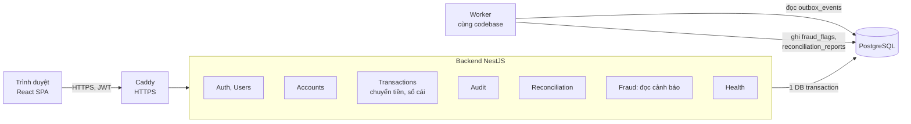
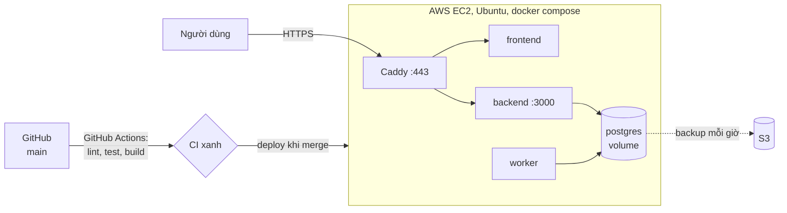

# Kiến trúc hệ thống

Yêu cầu: [BRD](../brd/README.md), [SRS](../srs/README.md), [FRS](../frs/README.md). Lý do của từng lựa chọn: [adr/](../adr/).

## 1. Tổng quan

**Modular monolith** (ADR 001): một backend NestJS chia module rõ ràng, dùng một PostgreSQL (ADR 002). Việc cần kết quả ngay chạy đồng bộ trong request; việc nền chạy ở một worker cùng codebase (ADR 003).

Phần đã chạy: React SPA (đang hoàn thiện), backend, PostgreSQL. Worker và Caddy làm ở tuần 6 đến 8.

## 2. Các module

| Module | Trách nhiệm | Bảng chính | Phụ trách |
|---|---|---|---|
| `auth`, `users` | Đăng ký, đăng nhập JWT, guard, vai trò, khóa user | `users` | TV2 |
| `accounts` | Số dư, tạo tài khoản khi đăng ký, khóa và mở tài khoản ngân hàng | `accounts` | TV3, F3 do TV2 |
| `transactions` | Chuyển tiền, Idempotency-Key, ghi sổ cái kép, lịch sử | `transactions`, `ledger_entries`, `idempotency_keys` | TV3 |
| `audit` | Ghi và tra cứu audit log, module khác gọi `AuditService` | `audit_logs` | TV2 |
| `fraud` (tuần 8) | Luật phát hiện bất thường, cảnh báo cho Operator | `fraud_flags`, `outbox_events` | TV3 |
| `reconciliation` (tuần 8) | Đối soát số dư với sổ cái | `reconciliation_reports` | TV1 |
| `health` | Kiểm tra app và DB | | TV5 |
| `common`, `database` | Định dạng lỗi, requestId, migration, seed | | TV1 |

**Quy tắc ranh giới:** module chỉ gọi nhau qua service được export (ví dụ `AccountsService`, `AuditService`), không truy vấn thẳng bảng của module khác. Tất cả dùng chung một DB để chuyển tiền giữ được ACID; ranh giới module giúp sau này tách worker hay fraud ra service riêng mà không phải sửa nghiệp vụ.

## 3. Đồng bộ và bất đồng bộ

| Việc | Cách chạy | Lý do |
|---|---|---|
| Đăng nhập, xem số dư, lịch sử | Đồng bộ | Người dùng cần kết quả ngay |
| Chuyển tiền: khóa, trừ, cộng, sổ cái, idempotency, audit | Đồng bộ, **một DB transaction** | Phải nhất quán mạnh |
| Lưu giao dịch `failed` | Đồng bộ, transaction riêng sau rollback | Giữ lại lý do lỗi mà không ảnh hưởng rollback |
| Phát hiện bất thường | Bất đồng bộ: chuyển tiền ghi sự kiện vào `outbox_events` trong cùng transaction, worker đọc sau | Không làm chậm chuyển tiền, không mất sự kiện khi crash (ADR 007) |
| Đối soát | Bất đồng bộ, worker chạy mỗi ngày | Việc nặng, không cần ngay |
| Quét giao dịch treo ở `processing` | Bất đồng bộ, worker chạy định kỳ | Xử lý tình huống service chết giữa chừng |

## 4. Luồng chuyển tiền

Chi tiết: [sequence-chuyen-tien.md](../sequence-chuyen-tien.md).

1. Client gửi `POST /api/transactions/transfer` kèm JWT và `Idempotency-Key` sinh khi mở form.
2. Mở DB transaction. Giữ chỗ key bằng `INSERT ... ON CONFLICT DO NOTHING`:
   - Key đã có, cùng nội dung: trả lại response cũ.
   - Key đã có, khác nội dung: `409`.
3. Khóa hai tài khoản bằng `SELECT ... FOR UPDATE` **theo thứ tự số tài khoản** (ADR 004).
4. Kiểm tra: tài khoản nguồn thuộc user, hai bên `active`, đủ số dư.
5. Cập nhật số dư bằng SQL (`balance = balance - :amount`), ghi giao dịch `completed`, 2 dòng sổ cái, lưu response vào idempotency key.
6. Commit. Lỗi ở bất kỳ bước nào thì rollback toàn bộ.

DB kiểm tra thêm lúc commit: giao dịch `completed` phải có đúng 1 dòng debit và 1 dòng credit cân nhau, sai thì commit bị từ chối (ADR 005).

## 5. Xử lý lỗi

| Lỗi | Hệ thống phản ứng thế nào |
|---|---|
| Lỗi giữa lúc trừ và cộng tiền | Rollback cả transaction |
| Client gửi lại do timeout | Idempotency-Key trả kết quả cũ |
| Backend chết giữa transaction | PostgreSQL tự rollback phần chưa commit |
| Backend chết sau commit, trước khi xử lý sự kiện | Sự kiện vẫn nằm trong `outbox_events`, worker xử lý khi chạy lại |
| Worker chết | Sự kiện chờ trong outbox, chuyển tiền không bị ảnh hưởng |
| Hai lệnh chuyển cùng lúc | Khóa dòng theo thứ tự cố định, lệnh sau chờ lệnh trước |
| DB không phản hồi | `/api/health` trả `503`, Docker đánh dấu container không khỏe |
| Lộ mật khẩu DB của backend | User `bank_app` không sửa, xóa được sổ cái và audit log |

## 6. Bảo mật theo lớp

| Lớp | Biện pháp |
|---|---|
| Mạng | HTTPS qua Caddy, chỉ mở cổng 443 và 22 (giới hạn IP), không mở cổng DB |
| Xác thực | JWT 15 phút, bcrypt cost 12, mỗi request kiểm tra trạng thái user trong DB |
| Phân quyền | `RolesGuard` theo 4 vai trò, kiểm tra chủ sở hữu ở tầng service, truy cập dữ liệu người khác trả `404` |
| Dữ liệu | User DB tách: `bank` (owner, migration) và `bank_app` (backend). Trigger chặn sửa, xóa sổ cái và audit log |
| Truy vết | `requestId` trong mọi response, log và audit log |
| Lạm dụng | Rate limit đăng nhập và chuyển tiền, tạm khóa khi đăng nhập sai nhiều lần (tuần 9) |

## 7. Triển khai

Giai đoạn hiện tại (ADR 006). Caddy, worker, tự động deploy và backup lên S3 là thiết kế dự kiến, TV5 làm trong tuần 6 đến 9:

Hướng nâng cấp khi có credit hoặc cần dự phòng: PostgreSQL chuyển sang RDS (backup và mã hóa có sẵn, nhiều zone), frontend sang S3 và CloudFront, backend và worker sang ECS Fargate. Kiến trúc module không đổi.

## 8. Công nghệ

| Phần | Lựa chọn |
|---|---|
| Backend | NestJS 12 (TypeScript, ES modules), TypeORM, class-validator, Swagger |
| Database | PostgreSQL 16 |
| Frontend | React 19, Vite, Tailwind CSS, Zustand, Axios |
| Test | Vitest: unit test và e2e trên DB thật |
| Đóng gói, CI | Docker, docker compose, GitHub Actions |
| Cloud | AWS EC2, Caddy, S3 cho backup |
