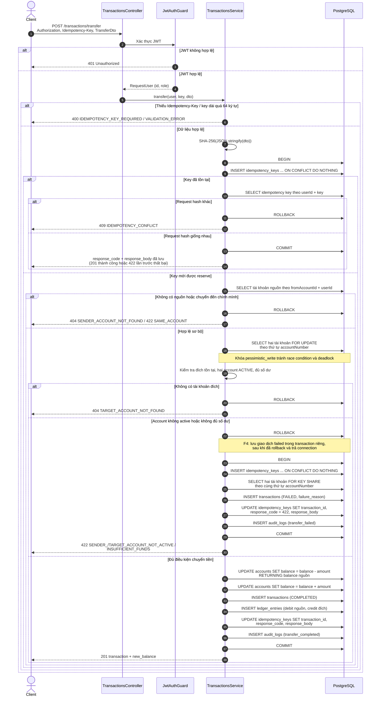

# Sequence diagram: Chuyển khoản

> Phụ trách: TV3 Nhật. Luồng `POST /api/transactions/transfer`: xác thực, idempotency, khóa tài khoản, ghi sổ cái, commit hoặc rollback, lưu giao dịch `failed` (F4).

