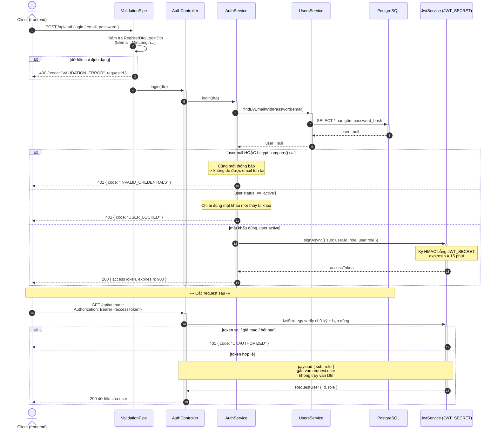

# Sequence diagram: Đăng nhập

> Phụ trách: TV2 Châu Anh. Luồng `POST /api/auth/login` và cách token được dùng ở các request sau.

## Các quyết định thiết kế

| Quyết định | Lý do |
|---|---|
| Sai email và sai mật khẩu trả **cùng một** `INVALID_CREDENTIALS` | Tránh để attacker dò được email nào đã đăng ký (user enumeration) |
| Kiểm tra `USER_LOCKED` **sau** khi so khớp mật khẩu | Chỉ người biết đúng mật khẩu mới biết tài khoản bị khóa |
| JWT thay vì session lưu DB | Server không giữ trạng thái; mọi bản copy của backend (Phase Cloud, nhiều container) chỉ cần chung `JWT_SECRET` là verify được token — không cần sticky session |
| Payload chỉ chứa `{ sub, role }` | Guard chỉ cần "ai + vai trò gì" mà không truy vấn DB mỗi request; không bao giờ chứa `passwordHash` |
| Token sống 15 phút | Giới hạn thời gian kẻ gian có thể dùng token đánh cắp. Việc gia hạn (refresh token) nằm ở Phase 2B |
| Đăng xuất làm ở frontend | Chỉ cần xóa token phía client; server không có session để hủy |
