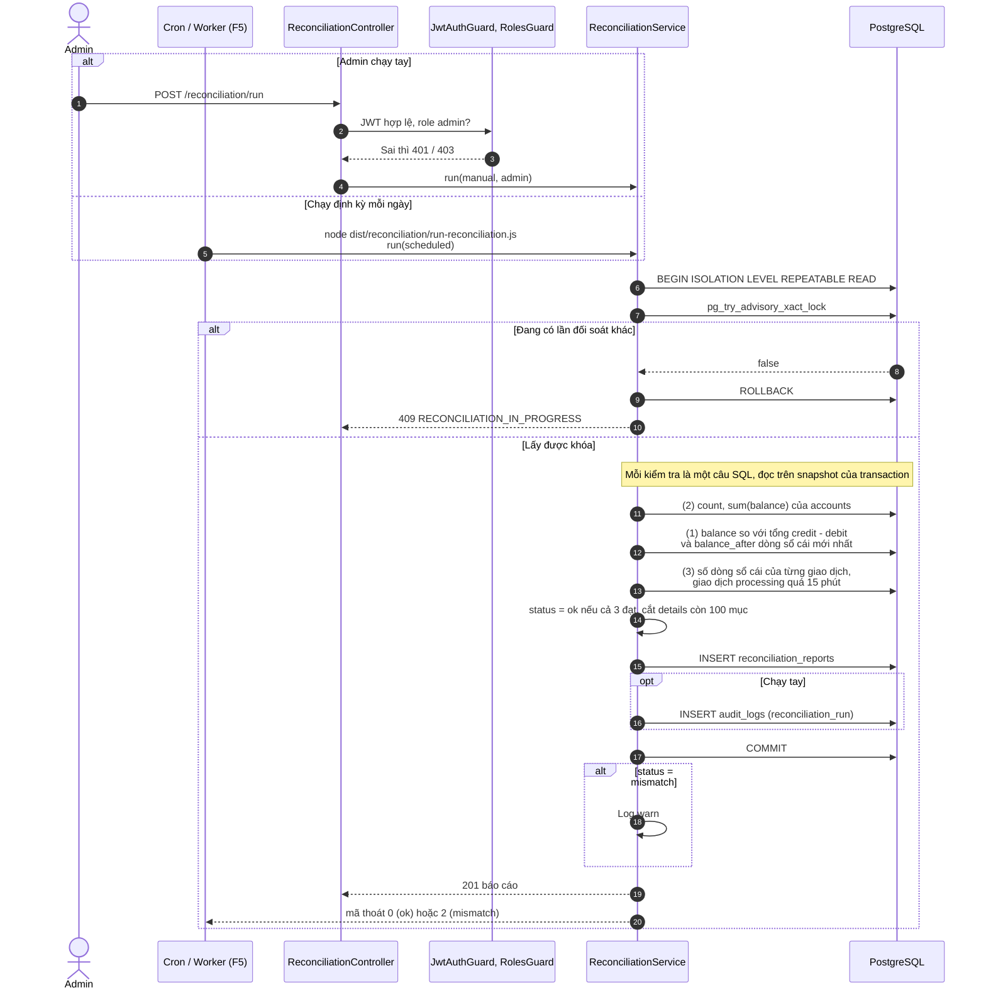

# Sequence diagram: Đối soát (F7)

> Phụ trách: TV1 Miền. Admin chạy tay qua `POST /api/reconciliation/run`, hoặc chạy định kỳ mỗi ngày bằng `run-reconciliation.js`. Cả hai gọi chung `ReconciliationService.run()`.

## Đối soát phát hiện được gì

Đối soát là lớp kiểm tra độc lập. Nó đứng sau các lớp chặn đã có: transaction của chuyển tiền, ràng buộc và trigger trong DB.

| Tình huống | Vì sao có thể xảy ra | Kiểm tra phát hiện | Test e2e |
|---|---|---|---|
| Số dư bị sửa thẳng trong DB, tổng toàn hệ thống lệch | Sửa tay, lỗi code cập nhật số dư mà không ghi sổ cái | (1) tài khoản lệch, (2) tổng khác 0 | 3 |
| Hai tài khoản lệch bù trừ nhau, tổng vẫn bằng 0 | Sửa tay cả hai bên | (1) từng tài khoản | 2 |
| Giao dịch `completed` thiếu hoặc lệch sổ cái | Trigger lúc commit chỉ áp dụng cho chuyển khoản, không áp dụng cho nạp tiền (`deposit`) | (3) `ledger_missing_or_unbalanced` | 4 |
| Giao dịch `failed`, `processing` lại có dòng sổ cái | DB không chặn trường hợp này | (3) `ledger_on_not_completed` | |
| Giao dịch treo ở `processing` | Service chết giữa chừng ở các luồng sau này có lưu trạng thái trung gian. Chuyển khoản hiện tại chạy trong một transaction nên chết giữa chừng là rollback, không để lại `processing` | (3) `stuck_processing` sau 15 phút | 5 |
| `balance_after` của dòng sổ cái mới nhất sai | Sửa sổ cái ở chế độ bảo trì | (1) so với `lastBalanceAfter` | |

## Khi chính việc đối soát gặp sự cố

| Tình huống | Xử lý | Test e2e |
|---|---|---|
| Đối soát chạy đúng lúc đang có chuyển tiền | Mỗi kiểm tra là một câu SQL nên không báo lệch giả. Không khóa bảng, chuyển tiền không bị chặn | 8 |
| Hai lần đối soát cùng lúc | Advisory lock, lần sau nhận `409`, script thoát mã 1 | 6 |
| DB lỗi giữa chừng | Transaction rollback, không có báo cáo dở dang. Script thoát mã 1 để cron báo lỗi | |
| Lộ credential của app | `banking_app` chỉ `SELECT`, `INSERT`, không sửa, xóa được báo cáo cũ | 7 |
| Quá nhiều mục lệch | `details` giữ 100 mục mỗi loại và bật `truncated`, các cột đếm vẫn đúng | Unit test |

## Lịch chạy

- Tạm thời dùng cron trên EC2, ví dụ 2 giờ sáng mỗi ngày: `0 2 * * * cd ~/CloudApplicationDevelopment && docker compose exec -T backend node dist/reconciliation/run-reconciliation.js`.
- Khi worker (F5) xong thì worker gọi `ReconciliationService.run({ trigger: 'scheduled' })` mỗi ngày, bỏ cron.
- Mã thoát 2 (lệch) là tín hiệu để cảnh báo. Gửi email cảnh báo qua outbox làm sau, cùng phần email của worker.
